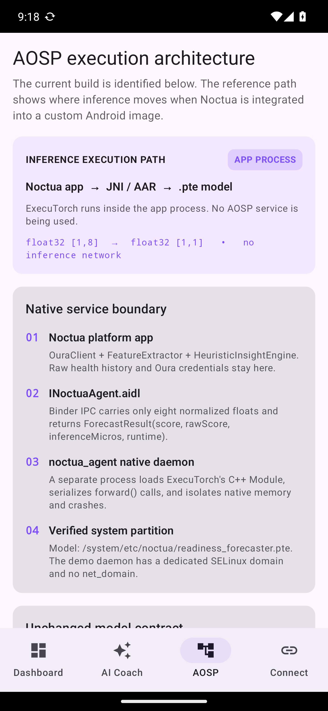

# Noctua as an AOSP OS-level agent

This demo moves Noctua's **ExecuTorch model execution** from the app process
into a native AOSP Binder service. It preserves Noctua's existing model contract:

```text
float32[1, 8] normalized wellness features
                  │
                  ▼
       readiness_forecaster.pte
                  │
                  ▼
        float32[1, 1] readiness score
```

The demo is intentionally small enough to explain on slides, but includes the
platform pieces an app-only demo normally skips: AIDL, ServiceManager, init,
Soong, SELinux, a native client, and a Kotlin adapter.

> **Demo scope:** the native service is the agent's inference engine. The
> optional coordinator shows where scheduling, policy, and actions belong. This
> is not a production health service, a medical device, or a stock Android API.

## Android Studio demo path

Open the Noctua repository root in Android Studio and run the **example-app**
configuration. Demo mode needs no Oura account. The dashboard shows the actual
execution host: **APP PROCESS**, **AOSP NATIVE SERVICE**, or **LINEAR FALLBACK**.

Tap **View AOSP architecture** (or the **AOSP** bottom-navigation item) to show
the Binder boundary, native daemon, model contract, agent loop, security rules,
and terminal proof commands. On the ordinary APK, the badge correctly remains
**APP PROCESS**; only the platform-signed AOSP variant can select the native
service path.



## 1. What changes from app-only Noctua?

### Current app architecture

```text
Oura API → noctua-core → FeatureExtractor → ExecuTorchForecaster
                                              │ Kotlin reflection
                                              ▼
                                     ExecuTorch AAR / JNI
                                              │
                                              ▼
                                       Compose UI
```

### AOSP architecture

```text
Noctua platform app                         AOSP native process
┌───────────────────────────┐              ┌────────────────────────────┐
│ OuraClient / DemoData     │              │ noctua_agent (init daemon) │
│ FeatureExtractor          │              │ INoctuaAgent AIDL          │
│ HeuristicInsightEngine    │   Binder     │ ExecuTorch C++ Module      │
│ BinderForecaster ─────────┼─────────────▶│ readiness_forecaster.pte   │
│ Compose UI                │  8 floats    │ portable CPU kernels       │
└───────────────────────────┘              └────────────────────────────┘
```

Only the normalized feature vector crosses IPC. Raw sleep periods, HRV history,
Oura tokens, and detailed biometric records remain in the app. The neural model
and its runtime are installed read-only on the system partition.

### Why a separate native daemon instead of system_server?

- ExecuTorch's stable runtime surface is C++; no JNI/AAR bridge is needed.
- A bad model load or native crash does not crash `system_server`.
- The daemon gets a narrow SELinux domain and no network capability.
- Memory use, threads, scheduling, and hardware backends are isolated.
- Binder still gives AOSP a typed, synchronous IPC contract.

Use a framework front-end when you need Android permissions, per-user state,
JobScheduler, NotificationManager, or other framework APIs. The supplied
`framework/NoctuaAgentCoordinator.java` illustrates that policy/action boundary.

## 2. Source map

```text
service/aidl/.../INoctuaAgent.aidl   Binder API
service/aidl/.../ForecastResult.aidl score + raw value + timing + runtime
service/src/NoctuaAgentService.cpp   validation, tensor creation, forward()
service/src/main.cpp                eager load + ServiceManager registration
service/noctua_agent.rc              init daemon definition
client/noctua_client.cpp             deterministic adb-shell demo client
app/BinderForecaster.kt              drop-in Noctua ReadinessForecaster
framework/NoctuaAgentCoordinator.java optional policy/action layer
sepolicy/                            daemon, service, shell, and app rules
scripts/build_executorch.sh          Android C++ runtime cross-compile
model/readiness_forecaster.pte       exact model copied from Noctua
```

## 3. Build the demo

### Prerequisites

Use a Linux AOSP build host and an AOSP `userdebug` device target. Also install
CMake, the Android NDK, and ExecuTorch's source-build Python prerequisites.
This repository contains integration source, not an AOSP checkout.

Pin the exporter and runtime to the same ExecuTorch release. Noctua's sample
model documentation identifies the 1.4.x family; the build script is written
against the ExecuTorch 1.4.1 source layout.

### Step A — export or reuse the model

The included file is byte-for-byte copied from
`Noctua/model/sample/readiness_forecaster.pte`. To retrain/export instead:

```bash
# From the Noctua repository root:
cd model
python export_readiness_forecaster.py
cp readiness_forecaster.pte ../aosp-noctua-agent/model/readiness_forecaster.pte
```

The input order must stay identical to `WellnessFeatures.toVector()`:

| Index | Normalized feature |
|---:|---|
| 0 | sleep debt / 10 |
| 1 | HRV z-score / 3 |
| 2 | readiness trend / 5 |
| 3 | (7-day readiness mean − 75) / 25 |
| 4 | (7-day sleep-score mean − 75) / 25 |
| 5 | temperature deviation / 2 |
| 6 | (sleep efficiency − 85) / 15 |
| 7 | (steps − 8000) / 8000 |

### Step B — cross-compile ExecuTorch C++ for Android

Do **not** copy the app's AAR into AOSP and assume it is a reusable system
library. Build the C++ runtime and required operator kernels for the device ABI.
The script builds shared runtime + portable operator libraries and stages their
headers under `prebuilts/`.

```bash
cd aosp-noctua-agent
export EXECUTORCH_ROOT=/absolute/path/to/executorch   # directory name matters
export ANDROID_NDK_ROOT=/absolute/path/to/android-ndk
./scripts/build_executorch.sh arm64-v8a
```

For an x86_64 Cuttlefish/emulator target, also run:

```bash
./scripts/build_executorch.sh x86_64
```

The demo starts with portable CPU kernels for the smallest integration surface.
After this works, an XNNPACK, Vulkan, QNN, or other backend can be introduced;
that is a model-export + runtime-linking decision, not an AIDL change.

### Step C — copy into AOSP and enable the device configuration

For example:

```bash
cp -R aosp-noctua-agent "$AOSP/vendor/noctua/aosp-noctua-agent"
```

Include `device-config.mk` from the product/device makefile, or add its contents
manually. It adds the binaries/model to `PRODUCT_PACKAGES` and the demo rules to
`BOARD_SEPOLICY_DIRS`.

Then build and flash the complete images. A Binder name, init rule, model file,
and SELinux policy cannot be installed correctly by pushing only one binary.

```bash
source build/envsetup.sh
lunch <your-userdebug-target>
m noctua_agent noctua_client noctua_model
# Flash/reboot using the normal flow for your device.
```

### Step D — verify the platform service

```bash
adb shell getenforce
adb shell service check noctua_agent
adb shell noctua_client
```

Expected output shape (the score and timing are runtime results, not constants):

```text
readiness=<0..100> raw=<model output> inference=<N> us runtime=ExecuTorch AOSP / portable CPU
```

Run a second input showing sleep debt, below-baseline HRV, and negative trend:

```bash
adb shell noctua_client 0.6 -0.5 -0.3 -0.4 -0.2 0.1 -0.4 0.3
```

Useful diagnostics:

```bash
adb shell dumpsys -l | grep noctua
adb shell logcat -s NoctuaAgent
adb shell dmesg | grep -i avc
```

An `avc: denied` message means the SELinux integration is incomplete; do not
solve it by making the whole device permissive or allowing `untrusted_app`.

## 4. Connect the Noctua app

### AIDL and platform API access

`BinderForecaster.kt` calls `android.os.ServiceManager`, which is a platform API,
not an SDK API. Build this Noctua variant with Soong using `platform_apis: true`,
link `noctua_agent_aidl-java`, and sign it with the platform certificate. See
`app/NoctuaAospDemo.bp.snippet`; merge it into your real app module rather than
building the snippet unchanged.

The included SELinux demo allows `platform_app` and `shell`. A normal APK
installed from Android Studio remains `untrusted_app` and is intentionally not
allowed to find/call this service.

### Choose the platform forecaster

In `NoctuaViewModel`, try the OS service before the existing app-local loader:

```kotlin
private fun loadForecaster(app: Application): ForecasterInfo {
    val platform = BinderForecaster()
    if (platform.isAvailable()) {
        return ForecasterInfo(
            platform,
            platform.runtimeInfo() ?: "AOSP · ExecuTorch",
            InferenceHost.AOSP_SERVICE,
        )
    }

    return runCatching {
        val file = File(app.filesDir, MODEL_FILE)
        if (!file.exists()) {
            app.assets.open(MODEL_FILE).use { input ->
                file.outputStream().use { input.copyTo(it) }
            }
        }
        val neural = ExecuTorchForecaster(file.absolutePath)
        if (neural.isAvailable()) {
            ForecasterInfo(neural, "neural · ExecuTorch", InferenceHost.APP_PROCESS)
        } else {
            ForecasterInfo(
                LinearHeuristicForecaster(),
                "linear fallback",
                InferenceHost.LINEAR_FALLBACK,
            )
        }
    }.getOrElse {
        ForecasterInfo(
            LinearHeuristicForecaster(),
            "linear fallback",
            InferenceHost.LINEAR_FALLBACK,
        )
    }
}
```

No change is needed to `NoctuaAI`: it already accepts any
`ReadinessForecaster`. Its existing fallback also handles a dead or unavailable
Binder service.

### Keep Binder off the UI thread

`ReadinessForecaster` is synchronous. Run analysis on an IO dispatcher in both
demo and live-data paths:

```kotlin
private suspend fun analyzeOffMain(snapshot: WellnessSnapshot) =
    withContext(Dispatchers.IO) { ai.analyze(snapshot) }

// Inside viewModelScope.launch, after obtaining the snapshot:
val report = analyzeOffMain(snapshot)
```

Do not call `waitForService()` from `onCreate()` or a Compose composition.

## 5. Turn inference into an OS-level agent

An agent needs more than `model.forward()`. Use this loop on the talk slide:

```text
TRIGGER → SENSE → INFER → DECIDE → ACT → AUDIT
```

| Stage | Noctua/AOSP implementation |
|---|---|
| Trigger | explicit request first; later JobScheduler, boot completed, or a consented health-data update |
| Sense | Noctua's Oura client + FeatureExtractor; later a Health Connect/provider adapter |
| Infer | `INoctuaAgent.forecast()` in the isolated native daemon |
| Decide | deterministic policy in `NoctuaAgentCoordinator`, separate from the neural model |
| Act | local notification first; privileged actions only after explicit authorization |
| Audit | model/runtime version, latency, action taken; never log raw biometrics |

The coordinator returns `SUGGEST_RECOVERY` below a transparent threshold and
posts a local notification containing no raw biometric history. Keep the action
suggestive: do not silently change DND, network, alarms, or power policy.

For multi-user devices, key requests/state by `UserHandle`, avoid cross-user
caches, and stop work when the user is stopped. For production API stability,
freeze/version the AIDL interface instead of using the demo's `unstable: true`.

## 6. Security and privacy checklist

- Model is read-only under `/system/etc/noctua/`; runtime/model ship together.
- Daemon has a dedicated SELinux domain and no network domain.
- Input count, finiteness, and normalization range are checked at IPC boundary.
- A mutex serializes `Module::forward()` across Binder threads.
- Only eight normalized floats enter the daemon; only the forecast leaves it.
- Demo clients are `shell` and platform-signed apps, not every installed app.
- For per-package authorization, put a signature-level permission check in a
  framework front-end; SELinux domain access alone is not a package permission.
- Add timeouts, caller rate limits, memory limits, and a battery/thermal policy
  before running larger models or scheduling background inference.
- Never log raw Oura responses, OAuth tokens, feature history, or health text.

## 7. Four-minute live demo script

1. **30 s — identify the current process.** On the dashboard, show the execution
   badge and path: APP PROCESS for the normal APK or AOSP NATIVE SERVICE on the
   custom image. This prevents “on-device” from hiding the architecture.
2. **30 s — show the platform boundary.** Tap **View AOSP architecture**. Point
   to the app, AIDL/Binder, native daemon, and verified system partition.
3. **30 s — show the unchanged contract.** Open `FeatureExtractor.kt` and point
   to `toVector()`; then open `INoctuaAgent.aidl` with `float[] features`.
4. **30 s — prove it is a platform service.** Run `service check noctua_agent`.
5. **45 s — run neutral and stressed inputs.** Run both `noctua_client` commands
   and compare score plus inference timing. Avoid promising a fixed score.
6. **45 s — show the C++ boundary.** In `NoctuaAgentService.cpp`, highlight
   `make_tensor_ptr({1, 8}, features)` and `module_.forward(input)`.
7. **30 s — make it an agent and close on privacy.** On the AOSP tab, show
   TRIGGER → SENSE → INFER → DECIDE → ACT → AUDIT. Raw biometrics and credentials
   never cross Binder, and the inference daemon has no network domain.

Keep the first terminal command as a backup recording/screenshot. If the app
integration fails, the shell client still demonstrates the complete AOSP path.

## 8. Questions the AOSP audience may ask

**Is this a HAL?** No. It is a framework/native system service. A vendor HAL is
appropriate when the interface abstracts vendor hardware; this demo's contract
is application-level inference. An accelerator backend can sit underneath.

**Why not load the model in system_server?** Native fault isolation, smaller
privilege surface, independent memory/thread policy, and direct C++ runtime use.

**Why Binder instead of a socket?** Typed AIDL, ServiceManager discovery, caller
identity, death handling, and standard AOSP tooling/SELinux integration.

**Does this run on stock Android?** No. It requires an AOSP image, platform
signing, init integration, and SELinux changes. The ordinary Noctua app remains
the app-local fallback.

**What changes for an LLM coach?** The AIDL boundary should become streaming and
asynchronous, with cancellation and backpressure; memory, thermal, storage, and
model-update policy become much more important. The tiny forecaster is the
right first demo because the platform mechanics remain visible.

## References

- AOSP AIDL backends and service registration:
  https://source.android.com/docs/core/architecture/aidl/aidl-backends
- AOSP SELinux customization:
  https://source.android.com/docs/security/features/selinux/customize
- ExecuTorch Android integration:
  https://docs.pytorch.org/executorch/main/using-executorch-android.html
- ExecuTorch C++ Module/Tensor APIs:
  https://docs.pytorch.org/executorch/main/using-executorch-cpp.html
